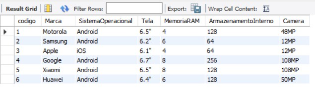
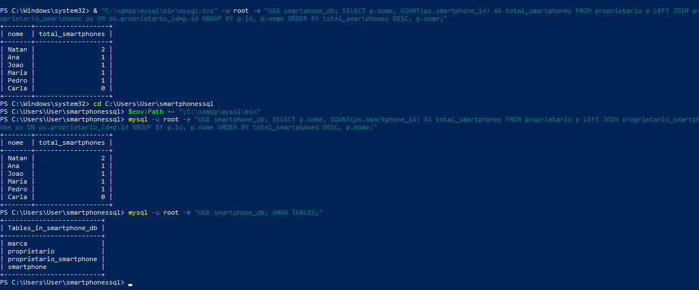

## Smartphone Project

[]()
[]()
[]()

## 📖 About the project

**Smartphones DB** is a relational database project developed in SQL to model information about manufacturers, smartphones, and their owners.

The goal is to demonstrate concepts such as relational modeling, normalization, referential integrity, table creation, relationships between entities, and the development of queries applied to real-world scenarios.

The model uses four entities. The associative table `proprietario_smartphone` represents the many-to-many relationship between owners and devices, avoiding data duplication and keeping the responsibilities of each table separate.

## Data model

| Entity                    | Responsibility                     |
| ------------------------- | ---------------------------------- |
| `marca`                   | Stores manufacturers               |
| `smartphone`              | Stores devices                    |
| `proprietario`            | Stores owners                     |
| `proprietario_smartphone` | Associates owners and smartphones |

```text
marca
  │
  └── smartphone
          │
          └── proprietario_smartphone
                         └── proprietario
```

## Referential integrity

The script uses:

- Primary keys to identify records;
- foreign keys to preserve relationships;
- `UNIQUE` constraints to prevent duplicates;
- `ON DELETE RESTRICT` to block deletions that would violate dependencies;
- `ON DELETE CASCADE` for controlled removal of relationships in the associative table;
- data types appropriate to the domain.

## ✨ Features

- Relational model creation;
- manufacturer registration;
- smartphone registration;
- owner registration;
- many-to-many relationships;
- use of an associative table;
- definition of primary and foreign keys;
- application of `UNIQUE` constraints;
- insertion of initial test data;
- SQL queries using `JOIN`;
- queries with aggregation functions;
- queries with subqueries;
- validation of integrity rules and constraint behavior.

### Validation query

The script includes queries applied to the model. The example below counts the smartphones associated with each owner:

```sql
SELECT p.nome, COUNT(ps.smartphone_id) AS total_smartphones
FROM proprietario p
LEFT JOIN proprietario_smartphone ps ON ps.proprietario_id = p.id
GROUP BY p.id, p.nome
ORDER BY total_smartphones DESC;
```

## 🖼️ Screenshots

### Relational model diagram


## Query grouped by owner



## Table listing



## 🚀 Technologies

- **SQL:** data definition and manipulation using DDL and DML;
- **MySQL:** relational database management system;
- **MariaDB:** compatible alternative for running the script.

## ⚙️ How to run

## Prerequisites

- Git;
- MySQL or MariaDB running;
- database command-line client or phpMyAdmin.

## Clone the repository

```bash
git clone https://github.com/seu-usuario/SmartphoneDB.git
cd SmartphoneDB
```

## Import with MySQL CLI

Run the script from the repository root:

```bash
mysql -u root -e "source SmartphoneDB.sql"
```

If the user requires a password, use:

```bash
mysql -u root -p -e "source SmartphoneDB.sql"
```

## Import with phpMyAdmin

1. Start MySQL or MariaDB;
2. open phpMyAdmin;
3. select the **Import** option;
4. select the `SmartphoneDB.sql` file;
5. confirm the execution.

## Verification

After importing:

1. Confirm that the four tables were created;
2. check the initial data;
3. run the queries using `JOIN`;
4. validate the aggregations, including `COUNT` and `AVG`;
5. test the `RESTRICT` and `CASCADE` constraints.

## 📂 Project structure

The repository contains the SQL script, documentation, and execution evidence:

```text
SmartphoneDB/
├── SmartphoneDB.sql
├── README.md
├── evidencias_execucao_01_consulta_agrupada.jpg
└── evidencias_execucao_02_listagem_tabelas.jpg
```

- `SmartphoneDB.sql`: table creation, constraints, test data, and queries;
- `README.md`: technical documentation;
- `evidencias_execucao_01_consulta_agrupada.jpg`: grouped query result;
- `evidencias_execucao_02_listagem_tabelas.jpg`: evidence of the created tables.

## 🌐 Deployment

Smartphones DB is a database project and does not have a web deployment. The script can be executed on any server compatible with MySQL or MariaDB.

Installation consists of importing `SmartphoneDB.sql` through MySQL CLI, phpMyAdmin, or another compatible tool. For remote use, simply run the script on a database instance with the permissions required to create tables, constraints, and records.

## 👤 Author

**Natan Da Luz**

- LinkedIn: [linkedin.com/in/natandaluz](https://www.linkedin.com/in/natandaluz/)
- Portfolio: [portfolionatan.vercel.app](https://portfolionatan.vercel.app/)
- E-mail: [natandaluz01@gmail.com](mailto:natandaluz01@gmail.com)

## 📄 License

This project does not currently have a defined license.
